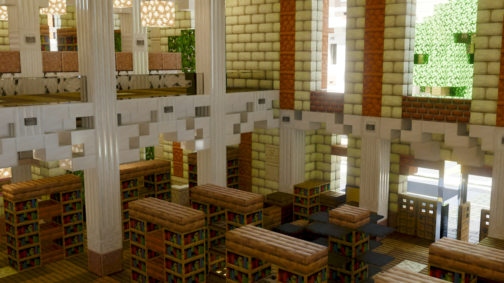

# BetterCaustica

BetterCaustica is a fork of [Caustica](https://github.com/ComfyFluffy/Caustica) by
ComfyFluffy, an experimental ray-traced renderer for Minecraft 26.2's Vulkan
backend. Caustica replaces the vanilla world view with hardware ray tracing and
NVIDIA DLSS features while keeping Minecraft's familiar UI and gameplay intact.

Both are early software. Expect bugs, missing visual cases, and frequent
changes while the renderer is being built.

## What this fork adds

Maintained by island_i. On top of upstream Caustica:

- Volumetric fog and clouds, with heterogeneous volume noise, weather-driven
  cloud thickening and evolution phase, and volume quality presets
- Water scattering inside the volumetric medium
- AMD FidelityFX (FSR) frame generation as a backend that runs on any
  Vulkan 1.3 device, next to the NVIDIA-only DLSS frame generation
- Fog and cloud debug views, with the matching Video Settings options
- Simplified and Traditional Chinese option translations
- Mod Menu and Sodium Config API entry points for the settings screen

The ray-tracing core, DLSS support and the ACES HDR pipeline are upstream's.

## Links

- [BetterCaustica Releases](https://github.com/mi60955-del/BetterCaustica/releases) — download the jar here
- [BetterCaustica source](https://github.com/mi60955-del/BetterCaustica)
- [Gallery](docs/gallery.md)

Upstream Caustica (this fork's builds are not published there):

- [Upstream repository](https://github.com/ComfyFluffy/Caustica)
- [Discord](https://discord.gg/SeWCjyKu2)
- [Modrinth](https://modrinth.com/mod/caustica)
- [CurseForge](https://www.curseforge.com/minecraft/mc-mods/caustica/preview)

## Features

- Vulkan hardware path-traced world rendering
- Volumetric fog, clouds and water scattering
- DLSS Ray Reconstruction support
- Frame Generation through DLSS (NVIDIA, experimental) or FSR (any Vulkan 1.3 device)
- HDR output
- Dynamic entity rendering in the ray-traced scene
- LabPBR-style material support
- OMM (Opacity Micro-Map) + SER (Shader Execution Reordering) optimizations

## Requirements

- **Vulkan graphics backend enabled**
- A GPU and driver with Vulkan ray tracing support
- NVIDIA RTX GPU and supported driver for DLSS features
- HDR-capable display and OS HDR mode for HDR output
- On Linux, an HDR-capable Wayland compositor and a native Wayland session for HDR output
- Install LabPBR resource pack like [SPBR](https://modrinth.com/resourcepack/spbr) for better visuals

## Installation

1. Install Fabric Loader for Minecraft `26.2`.
2. Install Fabric API.
3. Download `bettercaustica-<version>.jar` from [Releases](https://github.com/mi60955-del/BetterCaustica/releases) and put it in your Minecraft `mods` folder.
4. Launch the game with the Vulkan graphics backend.
5. Open Video Settings to adjust the renderer options.

BetterCaustica installs in place of upstream Caustica: the two jars share the
`caustica` system-property namespace, so remove Caustica first.

## Usage Notes

- Caustica is client-side only.
- DLSS Ray Reconstruction and Frame Generation require supported NVIDIA
  hardware and drivers.
- On Linux if Minecraft crashes on startup with stack overflow errors, try adding `-Xss2M` to the Java args to increase the stack size.
- Use Java args to improve performance. Minecraft Launcher default:
  `-XX:+UseCompactObjectHeaders -XX:+AlwaysPreTouch -XX:+UseStringDeduplication -XX:+UseZGC`
- Frame Generation is experimental and needs to be enabled by modifying the configuration file.
- HDR output requires an HDR swapchain and a correctly configured HDR display.
- When HDR is enabled on Linux, Caustica selects GLFW's native Wayland backend automatically. X11/XWayland surfaces generally do not expose the required HDR10/PQ format.
- If Minecraft falls back to OpenGL after a crash, re-enable the Vulkan backend
  before using Caustica again.

## Compatibility

Caustica takes over the world renderer, so other mods that heavily modify world
rendering, shader pipelines, post-processing, or the Vulkan backend may conflict.
UI-only mods are more likely to work.

Sodium is not supported and support is not planned. Caustica bypasses the vanilla
render path, so Sodium brings no performance gain while both mods claim the same
`LevelRenderer` entry point, the Vulkan device, and the Video Settings screen.
Neither mod declares a conflict, so the loader will happily start a broken
combination. Use separate profiles, or keep Sodium with Caustica's renderer
switched off (`-Dcaustica.rt=false`), which leaves Caustica inert.

## Status

Caustica is not a finished renderer yet. Current work focuses on visual
correctness, world coverage, stability, and making the SDR/HDR presentation
paths behave consistently.

## License

Caustica's project-owned source code and documentation are licensed under the
GNU Lesser General Public License v3.0 or later. BetterCaustica's changes are
licensed under the same terms. See [LICENSE.md](LICENSE.md),
[COPYING](COPYING), and [COPYING.LESSER](COPYING.LESSER).

Release artifacts may bundle NVIDIA DLSS/NGX SDK components under NVIDIA's own
license terms. See [THIRD_PARTY_NOTICES.md](THIRD_PARTY_NOTICES.md).

## TODO List

- [ ] Nether/End sky and weather
- [x] Volumetric fog and clouds (this fork)
- [ ] NRD denoising for non-NVIDIA GPUs
- [x] FSR frame generation for non-NVIDIA GPUs (this fork)
- [ ] LOD
- [x] ReSTIR emitter resampling
- [ ] ReSTIR temporal reservoir reuse (built and toggleable; so far it measures
      noisier than resampling from scratch, so its value is unproven)
