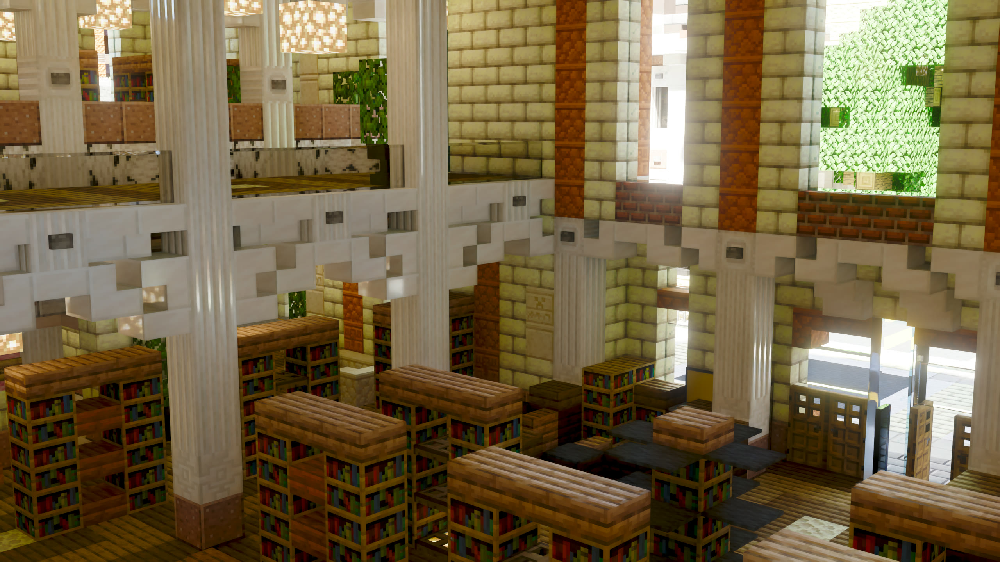

# BetterCaustica

[English](README.md) | 简体中文

BetterCaustica 是 [ComfyFluffy](https://github.com/ComfyFluffy) 的
[Caustica](https://github.com/ComfyFluffy/Caustica) 的分支，后者是面向 Minecraft
26.2 Vulkan 后端的实验性光线追踪渲染器。Caustica 用硬件光线追踪和 NVIDIA DLSS
系列功能替换原版世界渲染，同时保留 Minecraft 熟悉的界面与玩法。

两者都处于早期阶段：请预期 bug、缺失的视觉效果，以及渲染器开发期间频繁的变动。

## 本分支新增内容

由 island_i 维护。在上游 Caustica 的基础上：

- 体积雾与体积云：异质体积噪声、随天气增厚的云层、九种烘焙云形状与体积质量预设
- 独立于体积雾的太阳光束（丁达尔光），并带独立的水下光束控制（默认关闭以节省帧时间）
- 锐化与镜头光晕后期效果
- 面向 LabPBR 高度图的视差样式（锐利/平滑）与视差自阴影
- DLSS-RR 透明层与引导缓冲修复、实体纹理修复，以及受伤/生成闪光叠加层
- AMD FidelityFX（FSR）帧生成后端，可在任意 Vulkan 1.3 设备上运行，与仅限
  NVIDIA 的 DLSS 帧生成并列
- 雾与云的调试视图，以及对应的视频设置选项
- 简体中文与繁体中文选项翻译
- Mod Menu 与 Sodium Config API 设置入口
- 游戏内光线追踪开关（默认 F9）

光线追踪核心、DLSS 支持与 ACES HDR 管线来自上游。

## 链接

- [BetterCaustica 发布页](https://github.com/mi60955-del/BetterCaustica/releases) — 在此下载 jar
- [BetterCaustica 源码](https://github.com/mi60955-del/BetterCaustica)
- [画廊](docs/gallery.md)

上游 Caustica（本分支的构建不会发布在那里）：

- [上游仓库](https://github.com/ComfyFluffy/Caustica)
- [Discord](https://discord.gg/SeWCjyKu2)
- [Modrinth](https://modrinth.com/mod/caustica)
- [CurseForge](https://www.curseforge.com/minecraft/mc-mods/caustica/preview)

## 功能

- Vulkan 硬件路径追踪世界渲染
- 体积雾、烘焙体积云，以及晴空/水下太阳光束
- 后期效果：锐化、镜头光晕、泛光强度与 AgX 色调控制
- DLSS 光线重建支持，包含透明层与引导缓冲修复
- 通过 DLSS（NVIDIA，实验性）或 FSR（任意 Vulkan 1.3 设备）进行帧生成
- HDR 输出
- 动态实体渲染：受伤/生成闪光叠加、附魔光泽与纹理槽位回收
- 视差高度映射：锐利/平滑样式与自阴影
- LabPBR 风格材质支持
- OMM（不透明度微图）+ SER（着色器执行重排序）优化
- 游戏内光线追踪开关，以及 Mod Menu / Sodium Config 设置界面

## 需求

- **启用 Vulkan 图形后端**
- 支持 Vulkan 光线追踪的 GPU 与驱动
- 使用 DLSS 功能需要 NVIDIA RTX GPU 与受支持的驱动
- HDR 输出需要支持 HDR 的显示设备，并在系统中开启 HDR 模式
- Linux 上的 HDR 输出需要支持 HDR 的 Wayland 合成器与原生 Wayland 会话
- 安装 LabPBR 资源包（如 [SPBR](https://modrinth.com/resourcepack/spbr)）以获得更好的画面

## 安装

1. 为 Minecraft `26.2` 安装 Fabric Loader。
2. 安装 Fabric API。
3. 从 [Releases](https://github.com/mi60955-del/BetterCaustica/releases) 下载
   `bettercaustica-<version>.jar`，放入 Minecraft 的 `mods` 文件夹。
4. **FSR 帧生成无需额外下载**：从 0.1.1 起的发布 jar 已内置 AMD 的
   `amd_fidelityfx_vk.dll` 与项目自带的 `ffxshim.dll`，FSR 后端首次加载时模组会把
   两者解压到 `<游戏目录>/bettercaustica-ffx/natives/windows-x64/`。自行构建且
   构建时未设置 `FFX_SDK` 的 jar 不含这两个文件，需要手动复制，也可以用
   `-Dcaustica.ffx.path` 指向同时存放这两个 DLL 的文件夹。两种情况下 DLSS
   帧生成都不受影响。
5. 使用 Vulkan 图形后端启动游戏。
6. 打开视频设置调整渲染器选项，或在游戏内按 F9 切换光线追踪（可在
   “控制 → Caustica” 中改键）。

BetterCaustica 会替代上游 Caustica 安装：两个 jar 共用 `caustica` 系统属性命名空间，
因此请先移除 Caustica。

## 使用说明

- Caustica 仅客户端可用。
- DLSS 光线重建与 DLSS 帧生成需要受支持的 NVIDIA 硬件与驱动。
- 在 Linux 上，如果 Minecraft 启动时因栈溢出崩溃，可在 Java 参数中加入
  `-Xss2M` 增大栈大小。
- 使用 Java 参数改善性能。Minecraft 启动器默认值：
  `-XX:+UseCompactObjectHeaders -XX:+AlwaysPreTouch -XX:+UseStringDeduplication -XX:+UseZGC`
- 帧生成仍是实验性功能，需要在配置中开启。
- HDR 输出需要 HDR 交换链与正确配置的 HDR 显示设备。
- 在 Linux 上启用 HDR 时，Caustica 会自动选择 GLFW 的原生 Wayland 后端；
  X11/XWayland 表面通常不提供所需的 HDR10/PQ 格式。
- 如果 Minecraft 在崩溃后回退到 OpenGL，请重新启用 Vulkan 后端后再使用 Caustica。

## 兼容性

Caustica 接管世界渲染，因此其他大幅修改世界渲染、着色器管线、后期处理或
Vulkan 后端的模组可能发生冲突。仅修改界面的模组更有可能正常工作。

不支持 Sodium，也没有支持计划。Caustica 绕过原版渲染路径，因此当两个模组同时
占据 `LevelRenderer` 入口点、Vulkan 设备和视频设置界面时，Sodium 不会带来性能
收益。两者都没有声明冲突，加载器会直接启动这个有问题的组合。请使用独立配置，
或让 Sodium 与 Caustica 的渲染器关闭（`-Dcaustica.rt=false`，或在游戏内按 F9）
共存，此时 Caustica 保持惰性。

## 状态

Caustica 还不是一个完成的渲染器。当前工作重点是视觉正确性、世界覆盖范围、
稳定性，以及让 SDR/HDR 呈现路径的行为保持一致。

## 许可证

Caustica 的项目自有源代码与文档采用 GNU Lesser General Public License v3.0
或更高版本许可。BetterCaustica 的修改采用相同条款。参见 [LICENSE.md](LICENSE.md)、
[COPYING](COPYING) 与 [COPYING.LESSER](COPYING.LESSER)。

发布产物可能按 NVIDIA 自己的许可条款捆绑 NVIDIA DLSS/NGX SDK 组件。参见
[THIRD_PARTY_NOTICES.md](THIRD_PARTY_NOTICES.md)。

## TODO 列表

- [ ] 下界/末地天空与天气
- [x] 体积雾与体积云（本分支）
- [ ] 面向非 NVIDIA GPU 的 NRD 降噪
- [x] 面向非 NVIDIA GPU 的 FSR 帧生成（本分支）
- [ ] LOD
- [x] ReSTIR 发光体重采样
- [ ] ReSTIR 时序蓄水池复用（已实现且可开关；目前测得的噪声高于每帧重新采样，
      价值尚未证实）
