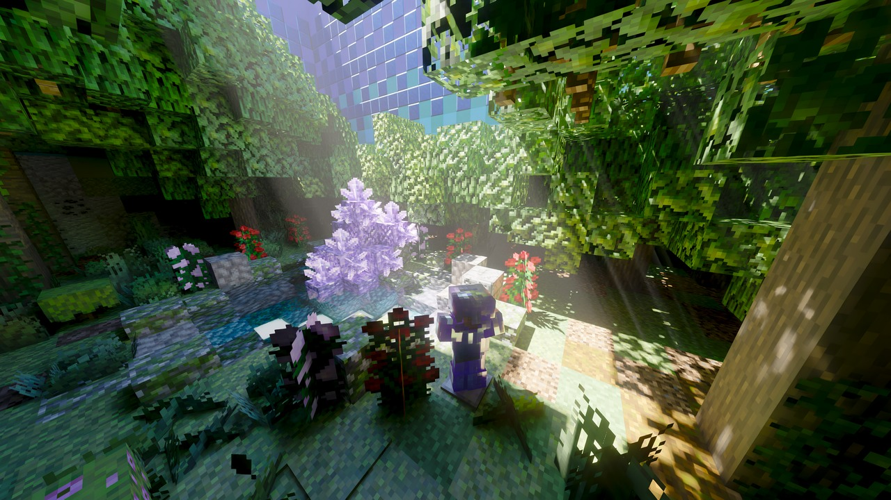
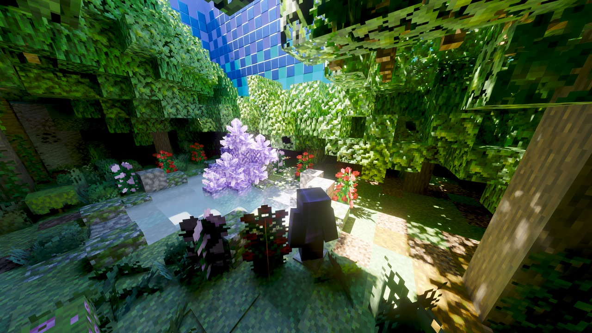

# BetterCaustica 0.1.1

**English** · **简体中文**

## English

The second public release. This update focuses on standalone sun shafts,
sharpening and lens flare post effects, baked volumetric clouds, and a large set
of entity, DLSS-RR and water/glass correctness fixes. Frames with every
volumetric switch off also save about 5.6 ms.

### Download and installation

- Requires Minecraft 26.2, Fabric Loader and Fabric API, and the **Vulkan**
  graphics backend.
- Put `bettercaustica-0.1.1.jar` in the `mods` folder.
- **For FSR frame generation**: download the AMD FidelityFX SDK (FSR 3.1) and copy
  `amd_fidelityfx_vk.dll` into `<game directory>/bettercaustica-ffx/natives/windows-x64/`
  (create the folder if it does not exist). The mod extracts its bundled
  `ffxshim.dll` beside it; if your jar was built without the FidelityFX natives,
  copy `ffxshim.dll` there as well. Without either file the FSR backend stays
  unavailable and DLSS frame generation is unaffected. A more convenient install
  method is planned. You can also point `-Dcaustica.ffx.path` at a folder holding
  both DLLs.
- Open Video Settings to adjust the renderer options, or press **F9** in-game to
  toggle ray tracing (rebindable under Controls → Caustica).

### Visual comparison

Same scene and viewpoint. Left is 0.1.1 (new), right is 0.1.0 (old).

<table>
  <tr>
    <th align="center">0.1.1 (new)</th>
    <th align="center">0.1.0 (old)</th>
  </tr>
  <tr>
    <td></td>
    <td></td>
  </tr>
</table>

#### What to look for

- **Sun shafts**: the new build shows Tyndall beams through the canopy on the
  right and under the glass roof at the upper left; the old build has only
  uniform ambient light. Sun shafts are now independent of volumetric fog, so
  they appear while the air stays clear.
- **Atmosphere and highlights**: the lit areas in the new build carry a thin
  scattering haze, and the glass roof and amethyst highlights roll off more
  softly; the old build has harder highlights and flatter shadows. This is also
  the result of the retuned AgX contrast/highlight range and bloom strength.
- **Entities**: the zombie in the old build is nearly a black silhouette; the new
  build restores correct entity lighting and materials, with the hurt/spawn flash
  and enchantment glint layered the way vanilla does.
- **Shadow depth**: the new canopy shadows keep more color-temperature and
  light/dark variation instead of collapsing into a flat dark area.

> Comparison images are half resolution and JPEG-compressed; no color grading or
> other post processing.

### What's new

#### Added

- Standalone sun shafts, with independent density and scatter ceiling for
  underwater beams
- Sharpening and lens flare post effects (starburst, chromatic halos, lens dust)
- Parallax styles (sharp/smooth) and parallax self-shadow
- AgX Contrast, AgX Highlight Range, Bloom Strength and Day/Night Fog Falloff
- F9 ray-tracing toggle; F3+A retries the RT path after a failure
- Nether portal emissive material
- Per-pass GPU timestamps (`-Dcaustica.rt.gpuTiming=true`)

#### Changed

- Clouds rebuilt as nine baked volumetric shapes; new **Cloud Size**, and Cloud
  Type renamed to **Cloud Shape**
- The old water scattering option is replaced by independent underwater sun-shaft
  controls
- Defaults retuned (lens flare, sharpening, AgX, clouds, water, sun shafts, etc.)

#### Fixed

- Nearest-first capture and ordering when entities exceed the capture budget
- DLSS-RR transparent-layer ghosting, fog-dominated guides, and water/glass
  refraction motion vectors
- Enchantment glint and hurt/spawn-flash overlays
- Entity texture slot exhaustion and charged-creeper slot leaks
- Refraction/total internal reflection on thin translucent blocks such as glass
  panes
- Water reflections leaking below the surface; black surfaces in sky-less
  dimensions such as the Nether
- Block sprite seams, FSR frame-generation size, stale generated frames with RT
  off, and RT output-mode logging

#### Performance

- Volume-free raygen when all volumetric effects are off: 37.7 → 47.2 fps at a
  fixed test point (about 5.6 ms)
- Automatic block material page sizing, entity texture slot reuse, and no
  full-screen UI blit with RT off

Full entries: [CHANGELOG.md](../../CHANGELOG.md).

### Upgrading

- Defaults were retuned in 0.1.1; an existing `config/bettercaustica.toml` is not
  overwritten.
- Sun Shafts are off by default: the per-pixel sun-visibility probes are
  expensive, so enable them in the volume settings when needed.
- Removed config keys are ignored; no manual cleanup is needed.
- Coming from upstream Caustica, remove the upstream jar first: both share the
  `caustica` system-property namespace.

### Known issues

- FSR frame generation needs `amd_fidelityfx_vk.dll` placed manually; if the jar
  does not bundle the natives, `ffxshim.dll` must be placed there too.
- Nether/End sky and weather are still TODO.
- Frame generation is experimental; generated frames are not preserved across RT
  toggles.

---

## 简体中文

第二个公开版本。本次更新集中在独立太阳光束、锐化与镜头光晕后期、烘焙体积云，
以及大量实体、DLSS-RR 与水面/玻璃正确性修复；体积全关时还额外省下约 5.6 ms。

### 下载与安装

- 需要 Minecraft 26.2、Fabric Loader 与 Fabric API，并使用 **Vulkan** 图形后端。
- 将 `bettercaustica-0.1.1.jar` 放入 `mods` 文件夹。
- 若要使用 **FSR 帧生成**：下载 AMD FidelityFX SDK（FSR 3.1），把
  `amd_fidelityfx_vk.dll` 放入 `<游戏目录>/bettercaustica-ffx/natives/windows-x64/`
  （文件夹不存在时请自行创建）。模组会把自带的 `ffxshim.dll` 解压到同一目录；
  若该 jar 未内置 FidelityFX 原生库，请把 `ffxshim.dll` 也放入该目录。缺少任一
  文件时 FSR 后端不可用，但不影响 DLSS 帧生成。后续会提供更便捷的安装方式。
  也可以用 `-Dcaustica.ffx.path` 指向同时存放这两个 DLL 的文件夹。
- 打开视频设置调整渲染器选项，或在游戏内按 **F9** 切换光线追踪
  （可在“控制 → Caustica”中改键）。

### 画面对比

同一场景、同一视角。左为新版 0.1.1，右为旧版 0.1.0。

<table>
  <tr>
    <th align="center">0.1.1（新）</th>
    <th align="center">0.1.0（旧）</th>
  </tr>
  <tr>
    <td></td>
    <td></td>
  </tr>
</table>

#### 对比说明

- **太阳光束**：新版在右侧树冠与左上方玻璃顶棚下都能看到穿过阴影的丁达尔光柱，
  旧版只有均匀的环境光。太阳光束现在独立于体积雾，因此空气保持清澈时也能出现。
- **大气与高光**：新版受光区域多了一层薄雾般的散射，玻璃顶棚与紫水晶的高光过渡更
  柔和；旧版的高光更硬、阴影更平。这也是重新调校的 AgX 对比度/高光范围与泛光
  强度的结果。
- **实体显示**：旧版画面中的僵尸接近黑色剪影；新版恢复正确的实体光照与材质，
  受伤/生成闪光与附魔光泽也能按原版规则叠加。
- **阴影层次**：新版的树冠阴影保留了更多色温与明暗变化，暗部不再糊成一片。

> 对比图为 1/2 分辨率、JPEG 压缩，未调色或做其他后期处理。

### 本版更新摘要

#### 新增

- 独立太阳光束（含水下光束的独立密度与散射上限）
- 锐化与镜头光晕后期（星芒、色散光环、镜头灰尘）
- 视差样式（锐利/平滑）与视差自阴影
- AgX 对比度、AgX 高光范围、泛光强度、雾昼夜衰减
- F9 光线追踪热键；F3+A 可作为失败后的重试
- 下界传送门自发光材质
- 逐 pass GPU 时间戳（`-Dcaustica.rt.gpuTiming=true`）

#### 改变

- 云层重建为 9 种烘焙体积形状，新增 **Cloud Size**，原 Cloud Type 改为
  **Cloud Shape**
- 旧的水体散射选项由水下太阳光束的独立控制取代
- 默认画质重新调校（镜头光晕、锐化、AgX、云层、水面与太阳光束等）

#### 修复

- 实体数量超过捕获预算时的近优先捕获与排序
- DLSS-RR 透明层鬼影、雾主导像素的引导、水面/玻璃折射的运动向量
- 附魔光泽、受伤/生成闪光叠加层
- 实体纹理槽位耗尽与充能苦力怕的槽位泄漏
- 玻璃板等薄半透明方块的折射/全反射
- 水面反射穿到水下、下界等无天空维度纯黑
- 方块贴图接缝、FSR 帧生成尺寸、RT 关闭时的陈旧生成帧、RT 模式日志

#### 性能

- 体积效果全关时使用无体积 raygen：固定测试点 37.7 → 47.2 fps（约 5.6 ms）
- 方块材质页尺寸自动选择、实体纹理槽位回收、RT 关闭时省去全屏 UI blit

完整条目见 [CHANGELOG.md](../../CHANGELOG.md)。

### 升级说明

- 默认设置在 0.1.1 中重新调校；已有的 `config/bettercaustica.toml` 不会被覆盖。
- 太阳光束（Sun Shafts）默认关闭：每像素的太阳可见性探针比较吃性能，需要时在
  体积设置中自行开启。
- 已移除的旧配置键会被忽略，不需要手动清理。
- 若从上游 Caustica 切换过来，请先移除上游 jar：两者共用 `caustica`
  系统属性命名空间。

### 已知问题

- FSR 帧生成需要手动放置 AMD 的 `amd_fidelityfx_vk.dll`；若 jar 未内置原生库，
  还需要把 `ffxshim.dll` 放入同一目录。
- 下界/末地的天空与天气仍在 TODO 中。
- 帧生成仍属实验性功能；启停光追时不会保留已生成的帧。
