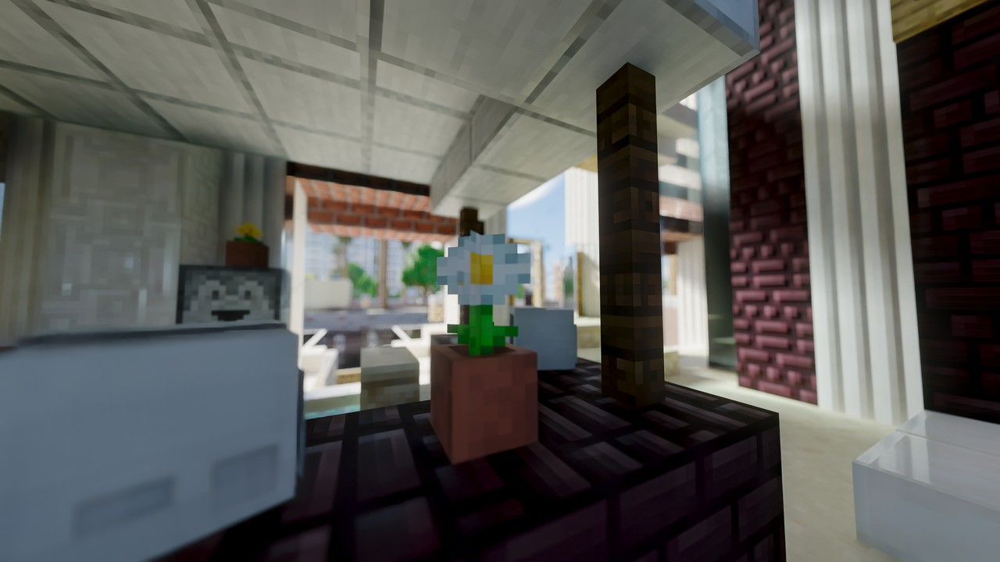

# BetterCaustica 0.1.2

**English** · **简体中文**

## What's new in pictures / 本版画面

Depth of field, the headline feature of this update. The focal plane rests on
the potted daisy; the counter in the foreground and the world outside the
window both give way to the lens.
本更新的主角是景深。焦平面落在盆栽雏菊上，前景的台面与窗外的一切都交给了镜头。

<figure>
  
  <figcaption><em>BetterCaustica 0.1.2 — depth of field / 景深</em></figcaption>
</figure>

> Screenshot is half resolution and JPEG-compressed; no color grading or other
> post processing.
> 截图为 1/2 分辨率、JPEG 压缩，未调色或做其他后期处理。

## English

The third public release. This update puts a lens on the camera — depth of
field, traced or post-process — adds a still-render hotkey that averages many
frames into one clean PNG, and rounds out the atmosphere: fog that carries sun
shadows, clouds that flow and vary their shapes across the sky, a haze that
closes in near a world border, and a fade that dissolves the render edge into
the sky.

### Download and installation

- Requires Minecraft 26.2, Fabric Loader and Fabric API, and the **Vulkan**
  graphics backend.
- Put `bettercaustica-0.1.2.jar` in the `mods` folder.
- **FSR frame generation needs no extra download.** This jar bundles the
  project-owned `ffxshim.dll` and AMD's `amd_fidelityfx_vk.dll` (FSR 3.1), and the
  mod extracts both to `<game directory>/bettercaustica-ffx/natives/windows-x64/`
  when the FSR backend first loads. A jar built without `FFX_SDK` carries neither
  file: copy `amd_fidelityfx_vk.dll` from the AMD FidelityFX SDK into that folder,
  and `ffxshim.dll` too if it is missing. `-Dcaustica.ffx.path` can point at a
  folder holding both DLLs. DLSS frame generation is unaffected either way.
- Open Video Settings to adjust the renderer options, or press **F9** in-game to
  toggle ray tracing (rebindable under Controls → Caustica).

### What the picture shows (image above)

- **Depth of field**: the potted daisy sits on the focal plane and keeps its
  edges; the white counter in the near foreground spreads into a wide blur disc,
  and the cityscape through the window softens with distance. The focal plane
  found the flower on its own through **Focus on View Centre**, which reads the
  depth the ray tracer measured at the middle of the frame.
- The blur is the **traced** mode: every primary ray samples a real point in the
  aperture, so softness is gathered the way a lens actually gathers light, and
  the denoiser assembles it over about a second of standing still.

### What's new

#### Added

- **Depth of field**, in two modes:
  - **Traced** — each primary ray samples a real aperture point, so a
    reflection, a glass pane or a fog beam blurs exactly as much as whatever it
    came through; the denoiser assembles the softness out of accumulated
    frames, settling after about a second of standing still.
  - **Post** — leaves the trace alone and defocuses the finished image from the
    depth the tracer measured; costs almost no frame time, needs no denoiser
    and works without DLSS-RR. Its opening can be cut into straight
    **Aperture Blades** for polygonal bokeh, with a rotation dial.
  - **Focus controls**: Focus on View Centre (auto-focus from the traced depth
    at the middle of the frame, gliding rather than jumping), Focus on
    Reflections (racks onto the image a reflector shows — the mountain in the
    lake — instead of the surface carrying it), a manual Focus Distance, and
    Focus Time, how long the plane takes to glide to a new depth.
  - **Blur caps**: Cap Blur Radius with Max Blur Radius and Cap Each Pixel hold
    the frame inside a widest-possible disc, which is what keeps a close wall a
    softness instead of blocks of colour; Pinhole Guides describe the scene to
    DLSS-RR from the pinhole ray so the reconstruction resolves the blur
    instead of painting over it.
  - Off by default; the Depth of field page holds every dial.
- **Still render** (F9's neighbour, **F10**, rebindable): averages a settable
  number of frames into one PNG — a clean, converged image of the world without
  stopping it. Moving the camera restarts the count; the sample count lives in
  the settings (Still Render Samples). Needs ray tracing in a world.
- **Fog Sun Shadows**: one shadow ray per pixel toward the sun or moon, so
  terrain, trees and buildings cut real light shafts out of the volumetric fog
  instead of the sun term staying unoccluded. A Fog Shadow Floor dial keeps
  milk in sealed rooms and shaded valleys. Off by default.
- **Random Cloud Shapes** (on by default): each district of the sky draws from
  all nine baked volumes instead of one shape dressing the whole sky; the
  choice is made per 4×4 instance grid, so neighbours still share a volume and
  the sky changes only at district borders. The Cloud Shape slider hides while
  this is on.
- **Cloud Flow**: a warp scrolls through the cloud shapes so edges undulate and
  interiors billow instead of the whole sky sliding rigidly; the pattern moves
  with the clouds — it reshapes them, never repositions them. 50% by default.
- **World Border Fog**: the air closes in as the camera approaches a world
  border. It joins the volumetric fog's own medium, so it scatters sun and sky
  like fog does and works with Volumetric Fog off. Inert at the default border
  (~30 million blocks out); shrink one (`/worldborder set 200`) to see it.
  Boundary Fog Density and Band dials. Off by default.
- **Render-Edge Fade**: distant terrain dissolves into the sky before the
  loaded world stops, so the hard stepped cliff at the horizon goes. A fade,
  not a fog — nothing is added to the air, so mid distance keeps its contrast
  and colour, and a mirror showing the far world carries the same fade. Edge
  Fade Opacity and Start dials; works with volumetric fog off. Off by default.

#### Changed

- The **Cloud Shape** slider itself: a hash minority of districts now borrow one
  of the slider order's two neighbouring shapes, so a single shape no longer
  repeats across the whole sky; the default shape moves from 0.2 to 0.85.
- **Weather Thickening** (rain): the deck now closes by growth — rain widens
  every cloud toward covering its share of the sky — instead of spawning more
  clouds.
- Defaults retuned: parallax self-shadow ships on, water opacity 1.0 → 3.0,
  sharpening 50% → 35%.

Full entries: [CHANGELOG.md](../../CHANGELOG.md).

### Upgrading

- An existing `config/bettercaustica.toml` is not overwritten; removed config
  keys are ignored. The old `dof.enabled` boolean migrates to the new
  `dof.mode` once, so a lens that was on stays on.
- Depth of field, Fog Sun Shadows, World Border Fog and Render-Edge Fade are
  off by default; Random Cloud Shapes and Cloud Flow ship on and change the
  look of the cloud deck on their own.
- Still render and the F10 binding need ray tracing enabled in a world.
- Coming from upstream Caustica, remove the upstream jar first: both share the
  `caustica` system-property namespace.

### Known issues

- FSR frame generation stays unavailable on a jar built without `FFX_SDK` until
  AMD's `amd_fidelityfx_vk.dll` is placed by hand.
- Nether/End sky and weather are still TODO.
- Frame generation is experimental; generated frames are not preserved across RT
  toggles.
- Traced depth of field needs a second of standing still to converge; a moving
  camera carries unresolved softness. Post mode has no such settle time.

---

## 简体中文

第三个公开版本。本次更新给相机装上了镜头——景深，可选光追或后期两种实现——
新增把多帧平均成一张干净 PNG 的静帧渲染热键，并补齐了大气的边角：
雾可以投出太阳阴影，云会流动、会各处不同形，世界边界附近会起霾，
渲染边缘则消融进天空。

### 下载与安装

- 需要 Minecraft 26.2、Fabric Loader 与 Fabric API，并使用 **Vulkan** 图形后端。
- 将 `bettercaustica-0.1.2.jar` 放入 `mods` 文件夹。
- **FSR 帧生成无需额外下载**。本 jar 内置了项目自带的 `ffxshim.dll` 与 AMD 的
  `amd_fidelityfx_vk.dll`（FSR 3.1），FSR 后端首次加载时模组会把两者解压到
  `<游戏目录>/bettercaustica-ffx/natives/windows-x64/`。若用的是构建时未设置
  `FFX_SDK` 的 jar，则两者都不在包内，需要自行把 AMD FidelityFX SDK（FSR 3.1）的
  `amd_fidelityfx_vk.dll` 放进该目录，必要时连 `ffxshim.dll` 一起放。
  也可以用 `-Dcaustica.ffx.path` 指向同时存放这两个 DLL 的文件夹。两种情况下
  DLSS 帧生成都不受影响。
- 打开视频设置调整渲染器选项，或在游戏内按 **F9** 切换光线追踪
  （可在"控制 → Caustica"中改键）。

### 画面说明（见上方截图）

- **景深**：盆栽雏菊落在焦平面上，边缘清晰；近处前景的白色台面摊成一片宽的
  弥散圆，窗外的城市则随距离逐渐软化。焦平面是通过**视野中心对焦**自己找到
  这朵花的——它读取光追在画面正中测得的深度。
- 这张虚化是**光追**模式：每条主光线都在光圈内取一个真实的采样点，柔和感是
  像真实镜头那样汇聚光线得来的，静止约一秒后由降噪器收敛完成。

### 本版更新摘要

#### 新增

- **景深**，两种模式：
  - **光追**——每条主光线采样一个真实的光圈点，因此反射、玻璃或雾光束的
    模糊程度与它所穿过的东西完全一致；柔和感由降噪器从累积的帧中组装，
    静止约一秒后收敛。
  - **后期**——不改动光线追踪，直接对完成画面按测得的深度散焦；几乎不占
    帧时间，不需要降噪器，没有 DLSS-RR 也能用。光圈可切成直边
    **光圈叶片**得到多边形焦外成像，并带旋转拨盘。
  - **对焦控制**：视野中心对焦（按画面正中的光追深度自动对焦，滑行而非
    跳变）、反射对焦（把焦平面拉到反射体**显示的东西**上——湖里的山——
    而不是承载它的水面）、手动对焦距离，以及对焦时间（焦平面滑到新深度
    要多久）。
  - **模糊上限**：模糊半径上限配合最大模糊半径与逐像素上限，把画面约束在
    一个最宽可行弥散圆内——贴脸的墙因而是柔和而不是色块；针孔引导让
    DLSS-RR 从针孔光线认识场景，重建出模糊而不是把它抹掉。
  - 默认关闭；Depth of field 页收纳全部拨盘。
- **静帧渲染**（F9 的邻居，**F10**，可改键）：把可设定数量的帧平均成一张
  PNG——世界不必停下就能得到一张干净收敛的画面。移动相机会重新计数；
  帧数在设置里（Still Render Samples）。需要在世界中开启光追。
- **雾的太阳阴影**：每像素朝太阳或月亮打一条阴影光线，地形、树木与建筑
  会在体积雾中切出真实的光影缺口，而不是太阳项不受遮挡地 uniform 发亮。
  雾阴影下限拨盘为密闭房间与阴影山谷保留奶感。默认关闭。
- **随机云形**（默认开启）：天空的每个区从九种烘焙体积中取形，而不是一种
  形状包办整片天；按 4×4 实例网格决定，相邻区仍共用一种体积，天空只在区
  界处变化。开启时 Cloud Shape 滑条隐藏。
- **云流动**：一个 warp 在云体形状中滚动，边缘起伏、内部翻涌，而不是整片
  天空刚性平移；图案跟随云移动——它重塑云，从不挪动云。默认 50%。
- **世界边界雾**：相机靠近世界边界时空气收拢。它加入体积雾自身的介质，
  像雾一样散射太阳与天空，体积雾关闭时也生效。默认边界（约 3000 万格外）
  不会触发；缩小边界（`/worldborder set 200`）即可看到。含边界雾密度与
  过渡带两个拨盘。默认关闭。
- **渲染边缘消融**：远处地形在已加载世界终止之前就溶入天空，地平线上那道
  硬阶梯悬崖随之消失。它是消融不是雾——不往空气里加任何东西，中景保持
  对比度与色彩，镜子里的远处世界也带着同样的消融。含边缘消融不透明度与
  起始点拨盘；体积雾关闭时也生效。默认关闭。

#### 改变

- **Cloud Shape** 滑条本身：现在有一小部分区按哈希借用滑条顺序上相邻两种
  形状之一，单一形状不再铺满整片天；默认形状从 0.2 移到 0.85。
- **天气增厚**（雨天）：云层靠生长闭合——雨把每朵云加宽到盖住它那份天空——
  而不是生成更多云。
- 默认画质调校：视差自阴影默认开启，水面不透明度 1.0 → 3.0，锐化
  50% → 35%。

完整条目见 [CHANGELOG.md](../../CHANGELOG.md)。

### 升级说明

- 已有的 `config/bettercaustica.toml` 不会被覆盖；已移除的旧配置键会被忽略。
  旧的 `dof.enabled` 布尔值会一次性迁移为新的 `dof.mode`，原来开着的镜头
  依旧开着。
- 景深、雾的太阳阴影、世界边界雾与渲染边缘消融默认关闭；随机云形与云流动
  默认开启，会直接改变云层的样子。
- 静帧渲染与 F10 键位需要在世界中开启光追。
- 若从上游 Caustica 切换过来，请先移除上游 jar：两者共用 `caustica`
  系统属性命名空间。

### 已知问题

- 若使用的是构建时未设置 `FFX_SDK` 的 jar，在手动放入 AMD 的
  `amd_fidelityfx_vk.dll` 之前 FSR 帧生成不可用。
- 下界/末地的天空与天气仍在 TODO 中。
- 帧生成仍属实验性功能；启停光追时不会保留已生成的帧。
- 光追景深需要静止约一秒来收敛；移动相机时柔和感尚未收敛完成。后期模式
  没有这个收敛等待。
