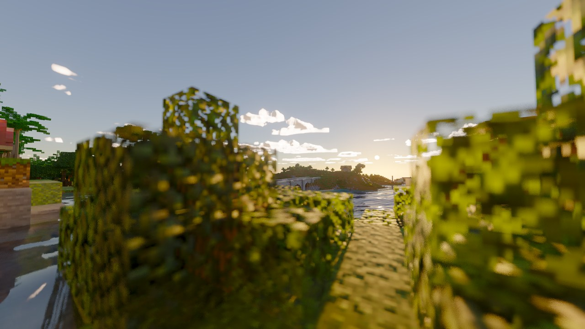

# BetterCaustica 0.1.3

**English** · **简体中文**

This release adds rain and wet surfaces, water absorption that differs by
colour, four procedural cloud layers, Distant Horizons LOD, lower-cost indirect
light, and more still-render, lens and DLSS-RR options.
本次更新新增雨与湿润表面、按颜色吸收的水、四层程序化云、Distant Horizons LOD 与
开销更低的间接光，并增加静帧渲染、镜头与 DLSS-RR 选项。

<figure>
  
  <figcaption><em>BetterCaustica 0.1.3 preview / 0.1.3 预览</em></figcaption>
</figure>

> Screenshot is half resolution and JPEG-compressed; no color grading or other post processing.
> 截图为 1/2 分辨率、JPEG 压缩，未调色或做其他后期处理。

## English

### Highlights

- **Rain** — rain now appears when ray tracing is on. **Rain Streaks** enables it,
  with count, length, width, brightness, wind speed and wind direction on the
  Sky & Clouds page. Snow is not drawn.
- **Wet surfaces and puddles** — surfaces become wet while it rains and dry slowly
  afterwards; **Rain Wetness** sets how wet they get. **Puddle Coverage** adds
  standing water on level ground; puddles reflect the sky and surroundings and
  darken the surface below. Emissive blocks, glass, foliage cutouts and entities
  do not get puddles. **Rain Sky Darkening** dims the sky, the light from it and
  the image during rain and thunder.
- **Water absorption** — water absorbs red about four times as fast as blue, and
  the biome tint only changes this ratio. **Water Opacity** controls the strength.
  With **Water Fog** off, water only absorbs light and adds no haze.
- **Procedural clouds** — the nine cloud volume textures, the shape slider and the
  random-shape switch are removed. Clouds are now four procedural layers: low
  cumulus, towering cumulus, altostratus and cirrus. Coverage ranges from 0% to
  200%; rain and thunder raise coverage and density. Added **Cloud Out-Scatter**,
  **Cloud Light Steps**, **Cloud Detail** and **Cloud Shadow Steps**. The mod jar
  is about 18 MB smaller.
- **Distant Horizons LOD** — with Distant Horizons installed, its far terrain
  appears when ray tracing is on. **LOD max distance** at 0 follows DH's render
  distance; **LOD emissive light** makes distant windows and lava glow at night;
  **LOD fetch budget** limits how much DH data is read per frame. The mod turns off
  DH's own distant rendering while this is on. It is off by default. Support is
  incomplete; see Known issues.
- **Indirect light** — added **Indirect Radiance Cache** and **Indirect Light
  Subsampling**, which reduce indirect-light cost. Subsampled indirect light is
  softer and slightly darker, and the cache updates a moment after a light
  changes.
- **Still render** — added **Endless Still Render** (press the still-render key
  again to finish and save), **Still Render Resolution** (in windowed mode, changes
  the window size for the run and restores it afterwards) and **Still Render
  Denoise** with **Still Render Denoise Strength**. Denoising is skipped when
  DLSS-RR is on.
- **Lens and DLSS-RR options** — added **Cat-Eye Bokeh** (corner highlights get
  the crescent shape), **Swirly Bokeh** (highlights stretch more toward the frame
  edges and rotate), **RR Input Spark Clamp** (reduces isolated bright pixels
  before DLSS-RR) and **Emitter Shadow Ray Depth Limit** (stops emitter shadow
  rays after the set number of bounces).

### Also in this release

- An option can now require another switch: when that switch is off, the option
  is greyed out; options the hardware cannot use are hidden. **Volumetric
  Quality** shows the tier matching the current settings, or Custom.
- **Focus Time** now moves focus at the same speed in both directions and cannot
  overshoot.
- Defaults have changed: lens flare, sharpening, fog, clouds, shafts, water fog and
  Distant Horizons LOD are off; still render is endless at 3840×2160.
- Fixed: the water surface inside boats, Xaero's Minimap waypoint rotation, and an
  incorrect reflection distance in DLSS-RR.

### Download and installation

- Requires Minecraft 26.2, Fabric Loader and Fabric API, and the **Vulkan**
  graphics backend. Put `bettercaustica-0.1.3.jar` in the `mods` folder.
- **FSR frame generation needs no extra download**: this jar bundles
  `ffxshim.dll` and AMD's `amd_fidelityfx_vk.dll` (FSR 3.1) and extracts both to
  `<game directory>/bettercaustica-ffx/natives/windows-x64/`. A jar built without
  `FFX_SDK` carries neither; copy `amd_fidelityfx_vk.dll` from the SDK into that
  folder, or point `-Dcaustica.ffx.path` at a folder holding both.
- **Distant Horizons LOD is optional**: with DH installed, the LOD switch draws
  its far terrain in the ray-traced world; without DH, nothing changes.
- Video Settings holds every renderer option. **F9** toggles ray tracing and
  **F10** starts a still render (both rebindable under Controls → Caustica).

### Upgrading

- An existing `config/bettercaustica.toml` is not overwritten; removed keys are
  ignored (`volume.cloud-type`, `volume.cloud-random-style`,
  `composite.water-spray` and the whole `[omm]` section).
- New installs use the default values: rain streaks, rain wetness and puddles
  are on; fog, clouds, shafts, water fog, lens flare and sharpening are off.
  Existing installs keep their own values.
- Rain streaks are visible only during rain and are not part of still renders.
  Distant Horizons LOD does nothing without DH. Upstream Caustica uses the same
  `caustica` system properties; remove the upstream jar before switching.

### Known issues

- **Distant Horizons LOD support is incomplete.** Caves and overhangs are missing.
  LOD terrain is flat-coloured, with no block textures or surface detail. LOD water
  reflects the sky and surroundings but has no underwater absorption. The
  brightness of distant windows and lava is approximate and does not always match
  the actual light sources. Distant terrain takes time to fill in completely.
- Only falling water is drawn; snow is not drawn, so a snowy biome gets the
  dimmed sky and wet ground with nothing falling.
- The indirect radiance cache updates a moment after a light changes, and
  subsampled indirect light is softer and slightly darker.

Full entries: [CHANGELOG.md](../../CHANGELOG.md).

---

## 简体中文

### 本版亮点

- **雨**——开启光线追踪时，画面中会显示雨。**雨丝**控制是否显示；数量、长度、宽度、
  亮度、风速与风向设置都在天空与云层页。雪不会显示。
- **湿润表面与水洼**——下雨时表面变湿，雨停后缓慢变干；**雨水湿度**控制变湿程度。
  **积水覆盖**在平坦地面生成积水；水洼反射天空与周围景物，并压暗下方表面。自发光
  方块、玻璃、植被镂空与实体上不会生成水洼。**雨天天空变暗**在雨与雷雨时降低天空、
  天空光照与画面亮度。
- **水吸收**——水对红光的吸收约为蓝光的四倍，群系染色只改变这个比例。**水体不透明度**
  控制吸收强度。**水体雾**关闭时，水只吸收光，不产生雾感。
- **程序化云**——移除了九个体积云纹理、形状滑块与随机云形开关。云改为四层程序化云：
  低层积云、高耸积云、高层云与卷云。覆盖度范围为 0–200%；雨与雷雨会提高覆盖度与
  密度。新增**云层外散射**、**云光照步数**、**云细节**与**云影步数**。jar 体积减少
  约 18 MB。
- **Distant Horizons LOD**——安装 Distant Horizons 后，开启光线追踪时其远景地形会
  显示在场景中。**LOD 最大距离**为 0 时跟随 DH 的渲染距离；**LOD 自发光**让远处的
  窗户与岩浆在夜间发光；**LOD 读取预算**限制每帧读取的 DH 数据量。开启时 DH 自带的
  远景渲染会关闭。该功能默认关闭。支持不完整，见“已知问题”。
- **间接光**——新增**间接辐射缓存**与**间接光抽采样**，降低间接光开销。抽采样后的
  间接光更软、略暗；光源变化后缓存需要一点时间更新。
- **静帧渲染**——新增**静帧渲染无限累加**（再次按静帧渲染键结束并保存）、
  **静帧渲染分辨率切换**（窗口模式下在运行期间改变窗口尺寸，结束后恢复）与
  **静帧渲染降噪**（含**静帧渲染降噪强度**）。DLSS-RR 开启时跳过降噪。
- **镜头与 DLSS-RR 选项**——新增**口径蚀**（画面边缘与四角的高光呈月牙形）、**旋焦**
  （高光越靠画面边缘拉得越长，并绕中心旋转）、**RR 输入尖峰钳制**（减少 DLSS-RR
  前的孤立亮点）与**发光方块阴影射线深度上限**（让发光方块的阴影射线在设定的反弹
  次数后停止）。

### 其它改动

- 选项可以要求另一个开关开启：该开关关闭时，选项变灰；硬件不支持的选项隐藏。
  **体积质量**显示当前设置对应的档位，没有对应档位时显示“自定义”。
- **对焦时间**现在两个方向的换焦速度相同，且不会过冲。
- 默认值变化：镜头耀斑、锐化、雾、云、光束、水体雾与 Distant Horizons LOD 默认关闭；
  静帧渲染默认为无限累加、3840×2160。
- 修复：船内水面、Xaero's Minimap 路标旋转，以及 DLSS-RR 中错误的反射距离。

### 下载与安装

- 需要 Minecraft 26.2、Fabric Loader 与 Fabric API，以及 **Vulkan** 图形后端。
  把 `bettercaustica-0.1.3.jar` 放进 `mods` 目录。
- **FSR 帧生成无需额外下载**：jar 已打包 `ffxshim.dll` 与 AMD 的
  `amd_fidelityfx_vk.dll`（FSR 3.1），首次加载时解压到
  `<游戏目录>/bettercaustica-ffx/natives/windows-x64/`。构建时未设置 `FFX_SDK`
  的 jar 不含这两个文件：请从 AMD FidelityFX SDK 复制 `amd_fidelityfx_vk.dll`
  进去，或用 `-Dcaustica.ffx.path` 指向存放两者的目录。
- **Distant Horizons LOD 是可选项**：安装 DH 后，LOD 开关会把它的远景地形绘制进
  光追场景；没有 DH 时不生效。
- 渲染选项都在视频设置里。**F9** 切换光线追踪，**F10** 开始静帧渲染（都可在
  控制 → Caustica 里改键）。

### 升级说明

- 已有的 `config/bettercaustica.toml` 不会被覆盖；已移除的配置键会被忽略
  （`volume.cloud-type`、`volume.cloud-random-style`、`composite.water-spray`
  与整个 `[omm]` 段）。
- 全新安装的默认值：雨丝、雨水湿度与积水开启；雾、云、光束、水体雾、镜头耀斑与
  锐化关闭。已有安装保留自己文件里的值。
- 雨丝只在下雨时显示，静帧渲染不包含雨丝；没有 DH 时 Distant Horizons LOD 不生效。
  上游 Caustica 与本模组共用 `caustica` 系统属性，切换前请先移除上游 jar。

### 已知问题

- **Distant Horizons LOD 支持不完整。** 洞穴与悬挑结构不会显示；LOD 地形为纯色，
  没有方块纹理与表面细节；LOD 水面会反射天空与周围景物，但没有水下吸收；远处窗户
  与岩浆的亮度为近似值，与真实光源不完全一致；远景需要一段时间才能完整填充。
- 雨只包含落下的水，雪不会绘制；积雪群系只有变暗的天空与湿润地面，空中没有可见的
  降水。
- 间接辐射缓存对刚变化的光源有延迟；抽采样的间接光更软、略暗。

完整条目见 [CHANGELOG.md](../../CHANGELOG.md)。
